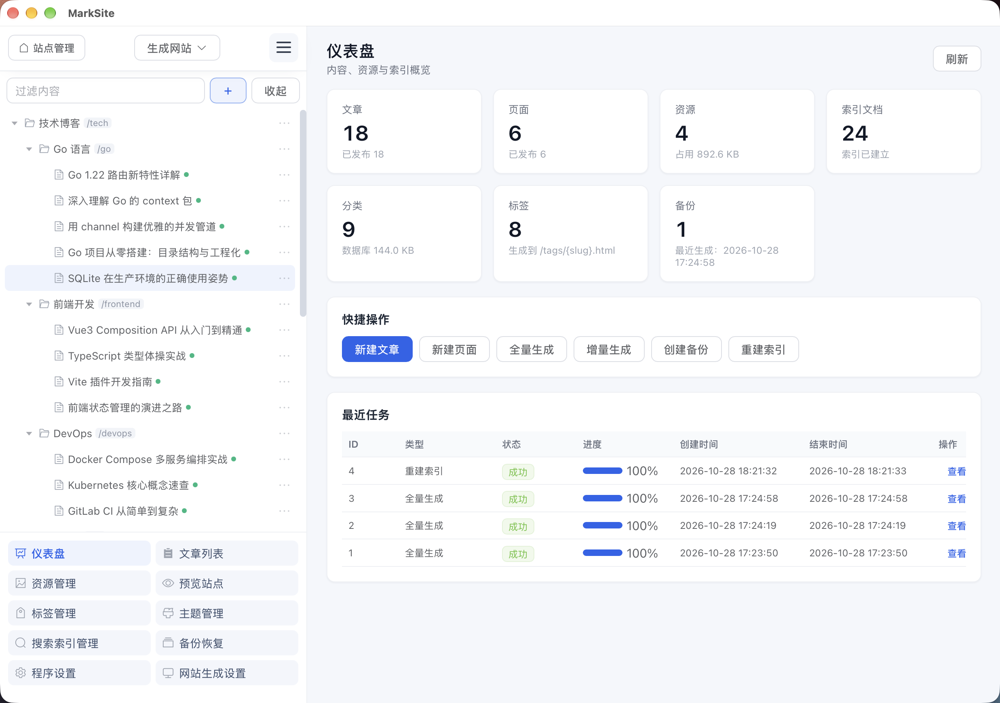
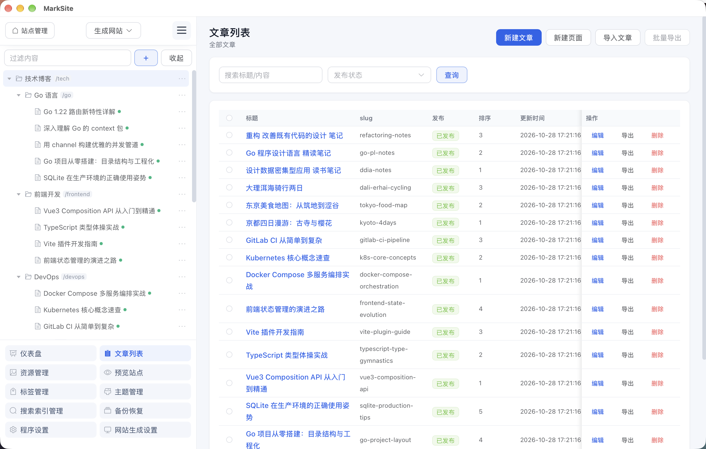
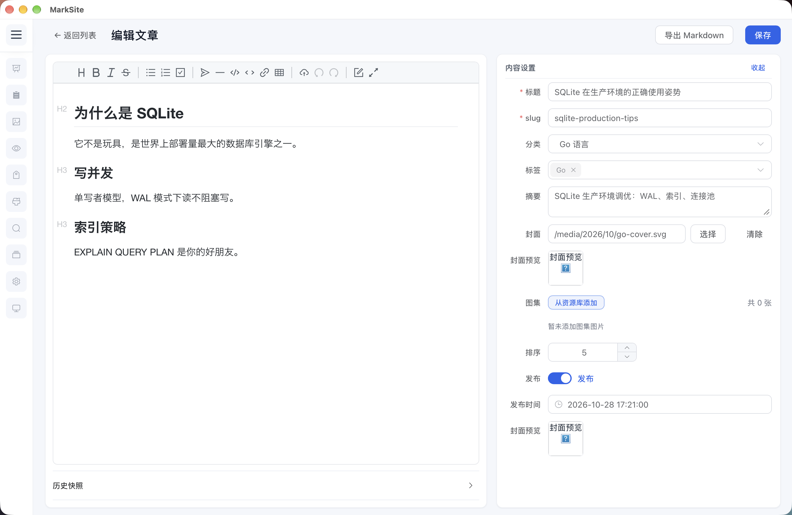

# MarkSite

单二进制、离线可用的静态站点管理与生成工具：内置内容管理后台、静态站点生成器和 macOS 桌面客户端。








## 功能

- 文章、独立页面、分类、标签、目录树管理，Markdown 编辑与实时预览
- 媒体资源库、站点配置、robots / sitemap / RSS
- 6 套内置主题，支持自定义主题（见 [主题指南](docs/THEME_GUIDE.md)）
- 全文检索、内容快照、自动备份、静态站点生成与本地预览
- 桌面端多站点管理：每个站点是一个独立工作目录，启动时可新建、打开、重命名、移除

## 技术栈

- 后端：Go 1.27、标准库 `net/http`、SQLite（modernc，纯 Go）、goldmark、bluge
- 前端：Vue 3 + Element Plus + Vite，构建产物通过 `go:embed` 嵌入二进制
- 桌面端：Wails v3

## 快速开始

### 桌面端（macOS）

前置：Go 1.27+、Node 20+、[Wails v3 CLI](https://v3.wails.io/)。

```bash
cd desktop
wails3 task package        # 产出 desktop/bin/MarkSite.app
wails3 task package:mac    # 再打包为 desktop/bin/MarkSite-1.0.0-macos.zip
```

启动后进入站点管理页，选择或新建一个站点目录即可。站点列表保存在
`~/Library/Application Support/MarkSite/desktop.json`。

### Windows

```bash
cd desktop
wails3 task package:windows     # 产出 desktop/bin/MarkSite-1.0.0-windows-amd64.zip
```

交叉编译不需要 mingw 工具链（WebView2 后端为纯 Go）。Windows 10/11 自带 WebView2 运行时；
如系统缺失，需安装 [WebView2 Runtime](https://developer.microsoft.com/microsoft-edge/webview2/)。

### 命令行 / 浏览器

```bash
./scripts/build.sh                      # 构建前端 + 编译 CLI，产出 ./marksite
./marksite -workdir /path/to/site       # 默认监听 127.0.0.1:8080
```

可选参数：`-addr host:port` 覆盖监听地址、`-open` 启动后自动打开浏览器。
需要示例内容时执行 `./marksite seed -workdir /path/to/site`。

## 开发环境

一次性准备：Go 1.27+、Node 20+、[Wails v3 CLI](https://v3.wails.io/)；
前端依赖由下面的命令首次运行时自动安装。

### 浏览器模式（一键启动）

```bash
./scripts/dev.sh
```

同时启动 Go 后端与 Vite，前端改动热更新：

- 后端：http://127.0.0.1:8080 （工作目录默认 `.dev/site`）
- 前端：http://localhost:5173 （`/api`、`/media` 代理到 8080）

可用环境变量覆盖：`MARKSITE_WORKDIR`（站点工作目录）、`MARKSITE_ADDR`（后端监听地址）。

### 桌面端热重载

```bash
cd desktop
wails3 task dev
```

Go 代码改动会自动重建并重开窗口；前端仍由 Vite（默认 9245 端口）热更新。
开发版桌面端内部接口固定 `127.0.0.1:8080`，便于 Vite 代理转发；如 8080 被占用，
用 `MARKSITE_DEV_ADDR=127.0.0.1:8090` 等自定义端口启动，并同步修改 `web/vite.config.ts` 的代理目标。

### 编辑器配置

仓库已包含 VS Code 配置：推荐扩展（Go、Vue - Official、EditorConfig）、保存时格式化、
Go 单步调试（`.vscode/launch.json`）与常用任务（`.vscode/tasks.json`：浏览器模式、桌面热重载、
构建前端、打包 macOS/Windows）。根目录 `.editorconfig` 统一缩进与换行。

## 目录结构

```
cmd/marksite/        CLI 入口（含 seed 子命令）
desktop/             Wails v3 桌面端：多站点管理页与打包任务
internal/            后端实现：db / repo / service / handler / router / generator / theme / fts / backup
internal/webui/      前端产物嵌入（dist 由构建生成，不纳入版本库）
web/                 Vue 3 前端源码
docs/                文档
scripts/             构建脚本
```

## 数据位置

每个站点就是一个工作目录：

```
<站点目录>/
├── data/      SQLite 数据库、媒体资源、主题、全文索引、备份
└── output/    生成的静态站点
```

## 构建说明

- `internal/webui/dist` 不入库。先构建前端再编译 Go（`desktop/Taskfile.yml` 与
  `scripts/build.sh` 已自动处理顺序）。
- `desktop` 打包使用 ad-hoc 签名（`codesign --sign -`）。从网络下载后首次打开若被
  Gatekeeper 拦截，可右键选择「打开」。

## 测试

```bash
go test ./...
```
